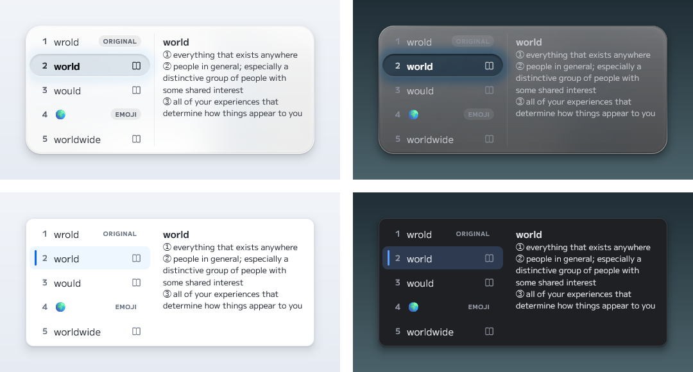
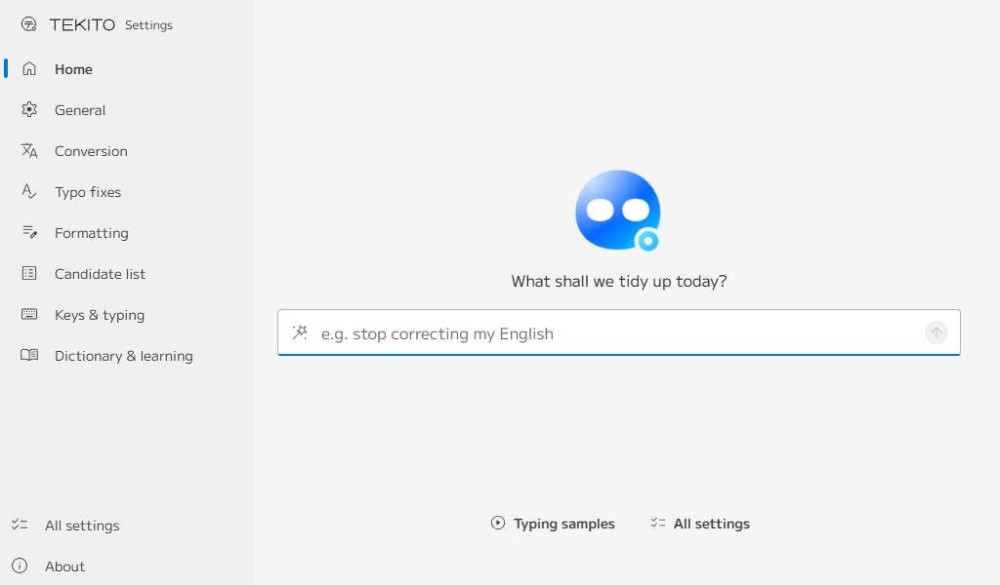

<p align="center">
  <picture>
    <source media="(prefers-color-scheme: dark)" srcset="docs/images/header-dark.png">
    
  </picture>
</p>

<p align="center">
  English and Japanese input for Windows.<br>
  English typos fixed on Space, romaji into Japanese that reads the whole sentence,<br>
  and nothing touched when you meant what you typed.
</p>

<p align="center">
  <a href="README_JP.md">日本語</a> ·
  <a href="#install">Install</a> ·
  <a href="#build">Build</a> ·
  <a href="https://capitata.dev">capitata.dev</a>
</p>

<p align="center">
  <br>
  <sub>English (Auto): Space, a comma or a period puts each slip right.</sub>
</p>

TEKITO is an input method (a TSF text service), so it works in ordinary
Windows apps without plugins. One input method types both languages: English
gets its spelling fixed as you go, and romaji becomes kana and kanji.
Everything runs on your PC. See [the compatibility notes](docs/compatibility.md)
for the apps it has been tried in.

## Modes

The button in the taskbar shows the mode. Click it to switch, or right-click
it to pick a mode, turn on Secret mode or open Settings.

<table>
  <tr>
    <td align="center"></td>
    <td><b>Auto</b><br>Corrects English spelling and suggests words as you type.</td>
  </tr>
  <tr>
    <td align="center">
      <picture>
        <source media="(prefers-color-scheme: dark)" srcset="docs/images/mode-direct-dark.png">
        
      </picture>
    </td>
    <td><b>Direct</b><br>Types exactly the keys you press.</td>
  </tr>
  <tr>
    <td width="72" align="center">
      <picture>
        <source media="(prefers-color-scheme: dark)" srcset="docs/images/mode-japanese-dark.png">
        
      </picture>
    </td>
    <td><b>Japanese</b><br>Turns romaji into kana and kanji.</td>
  </tr>
  <tr>
    <td align="center"></td>
    <td><b>Mix</b><br>Types Japanese and English without switching, a Space after each part.</td>
  </tr>
</table>

The switch key is Hankaku/Zenkaku on a Japanese keyboard and Alt+` on a US
one (or Ctrl+Space, Ctrl+Shift+Space, or none). It goes round the modes
checked under **Settings → General → Switch order**, in that order. On a
Japanese keyboard, Henkan switches to Japanese, Muhenkan to English, and
Hiragana to Japanese in hiragana (katakana with Shift).

Japanese input is optional. Without it, TEKITO has Auto and Direct only.
TEKITO stays off in terminals, in apps running as administrator, and in the
apps you list under **Settings → General**.

**Secret mode**: until you turn it off, nothing you type is learned or kept,
in every app. It turns off when you sign out or restart.

## Typing English

In Auto, type as usual. The word you are typing is underlined and a short
list of choices appears under it.

| Key | What it does |
| --- | --- |
| Space | Applies a confident correction and adds the space. Press again to step through the choices. |
| Shift+Space | Goes back to the previous choice. |
| Tab, ↑, ↓ | Moves through the list without committing. |
| Backspace | Right after a correction, puts back what you typed. |
| Esc | Keeps what you typed. |
| Enter | Picks the highlighted choice when you are in the list; otherwise ends the line as usual. |

TEKITO leaves alone words it knows, chat abbreviations like “brb”, anything
you capitalize yourself, anything that looks like code, URLs and addresses,
and fields marked as passwords, numbers or email.

Space also writes English the usual way: “i” becomes “I”, “dont” gets its
apostrophe, and days, months and names like “iPhone” get their capitals.
Where what you typed is a word too, like “cant”, it stays, with the other
spelling next in the list. The list also offers the word that often comes
next (“to” for “I want t”), and “today”, “heart” and “1+2=” offer the date,
♡ and 3. Each of these can be turned on or off in Settings.



## Typing Japanese

Type romaji in Japanese mode; it shows as hiragana, underlined. Space
converts the whole line, split into phrases, and a second Space opens the
list for the phrase in focus.

<p align="center">
  <br>
  <sub>Japanese: Space converts, with the slips put right.</sub>
</p>

<p align="center">
  <br>
  <sub>Live conversion: converted as you type, put right when you pause.</sub>
</p>

| Key | What it does |
| --- | --- |
| Space | Converts; then moves to the next candidate. Shift+Space goes back. |
| ← → | Before converting, moves the caret. After, moves between phrases. |
| Shift+← → | Makes the phrase in focus shorter or longer. |
| 1–9 | Picks a candidate from the list. |
| Tab, ↓ | Picks one of the predictions shown while you type. |
| Enter | Commits what is shown. |
| Esc | After converting, goes back to the kana; before, clears what you typed. |
| F6–F8 | Hiragana, katakana, half-width katakana. |
| F9, F10 | The letters you typed, full-width or as typed. |
| Shift+letter | Starts English inside Japanese (NHKの, Windows11). |
| Henkan | With nothing typed, converts the selected text again. |
| Ctrl+Backspace | Right after entering text, takes it back to the conversion. |
| Ctrl+Delete | Stops suggesting a candidate TEKITO learned. |

- **The whole sentence counts.** Conversion weighs which words go together
  and reads on from the text before the caret, and a small language model
  picks the sentence that reads most naturally.
- **Slips fixed.** When the keys look like a slip of the finger (a
  neighboring key, a key dropped or doubled, two swapped), Space converts
  what you meant (arigayou → ありがとう). What you typed stays in the list.
- **Whole stretches.** The list also offers the phrase and the ones after
  it written another way as a whole (きしゃにきいた → 記者に聞いた, 貴社に聞いた).
- **Meanings beside the list.** The highlighted candidate's meaning shows
  beside the list, so you can tell 初め from 始め. Slang such as エモい has
  one too.
- **Katakana with its English.** Loanwords and names offer the English word
  too (ミーティング → meeting, グーグル → Google).
- **Your words and your way.** The conversion you pick comes first next
  time. Add your own words under **Settings → Dictionary & learning**, and
  import words exported from Microsoft IME, Google Japanese Input or ATOK.
- **Numbers, dates and symbols.** 3こ becomes 3個 and 100えん 100円, in the
  style set under **Settings → Formatting**, where the kanji used (by
  school year, 常用, 人名用) are set too. きょう and いま offer the date and
  time, やじるし symbols, ねこ emoji, にこにこ emoticons and 1+2= its answer.
- **Postal codes.** Turn on **Postal codes to addresses** under
  **Settings → Candidate list**, and 1000001 converts to its address.
- **Live conversion.** Turn it on under **Settings → Conversion** to see
  the text converted as you type.
- **Kana input and the romaji table** are under **Settings → Keys & typing**.
- **Everywhere you type.** TEKITO works in the Start menu's search,
  Settings and Store apps too, and a katakana field (furigana) types
  katakana.

### Mix

Check Mix under **Settings → General → Switch order**, and type Japanese and
English without switching, a Space after each part: `kyouha github ni push
suru` becomes 今日はGitHubにpushする. Each part is taken as Japanese or
English on its own; names are written the way they are (GitHub), and a part
that reads both ways follows the sentence. Space again gives the other one.
A capital typed after Japanese starts English (`kyouhaZoom` → 今日はZoom),
and Enter enters what is shown.

<p align="center">
  <br>
  <sub>Mix: Japanese, English, the two together, and typed without spaces.</sub>
</p>

Live conversion works in Mix too, so a sentence typed without spaces
converts as you type:

<p align="center">
  <br>
  <sub>Mix with live conversion, typed without spaces.</sub>
</p>

### AI (optional)

Turn on **Check with AI** under **Settings → Conversion**, and an AI model
reviews your Japanese conversions. It runs on this PC, on the CPU, the GPU
or the NPU, and nothing you type leaves your PC. Light (about 360 MB) and
Accurate (about 1.6 GB) are offered.

Microsoft IME, Google Japanese Input and ATOK are trademarks of their
owners; they are named here only to say which files TEKITO reads. TEKITO
is not affiliated with them.

## Settings



Home finds a setting by its name. With the AI model downloaded, you can
also ask in your own words (“stop correcting my English”), and AI changes
the setting for you, with a way back. Each page shows what most people
change, and **More settings** at its end holds the rest; **All settings**
shows every setting on one page.

Your dictionary and what TEKITO learns can be encrypted under
**Settings → Dictionary & learning**, with a recovery code. Home's companion
can also sit in a corner of the desktop (**Settings → General**). Settings,
the setup program and TEKITO's messages are in English and Japanese.

## Privacy

Everything TEKITO does happens on your PC. It does not send your typing
anywhere, it has no account and no telemetry, and it does not use the
network while you type. What it learns stays in `%LOCALAPPDATA%\TEKITO` and
can be cleared from Settings. It downloads only what you choose: the
Japanese data, postal codes, an AI model, and what runs it on a GPU or an
NPU. See [the privacy notice](PRIVACY.md).

## Install

Download `TEKITO-1.0.0-full-installer.exe` from
[Releases](https://github.com/Canta360/tekito/releases/latest) and run it.

- **Add Japanese input** (on when Windows shows Japanese) downloads the
  Japanese dictionary and language data, about 232 MB, from the same release
  and checks it before installing. TEKITO then appears in the Japanese
  keyboard list.
- **Check with AI** also downloads the AI models, about 720 MB.
- Without Japanese, TEKITO appears in the English keyboard list with Auto
  and Direct. Japanese can be added later from Settings.
- It needs the Microsoft Edge WebView2 Runtime, which Windows 11 already has.

After installing, restart the apps you type in (or sign out and back in),
then pick TEKITO with Win+Space.

The installer is not code-signed, so Windows SmartScreen may ask you to
confirm before it runs. To install without a network, see
[the installer notes](installer/README.md).

## Build

You need Windows 11, Visual Studio 2026 (or 2022) with the C++ desktop
workload, CMake 3.24 or later, Python 3, and Node.js for the Settings page.

```powershell
cd apps\tekito-settings\ui
npm ci
npm run build
cd ..\..\..
cmake --preset windows-x64-debug
cmake --build --preset windows-x64-debug
.\scripts\verify.ps1
```

`verify.ps1` builds everything, runs the tests and checks
[the rules](CONTRIBUTING.md#rules). To try your build, register it from an
administrator PowerShell with `scripts\register-debug.ps1`, and remove it
with `unregister-debug.ps1`.

The language data lives in `data/`. The large packs are built from their
public sources: `scripts\ja\prepare-japanese-packs.ps1` for the Japanese
dictionary and language data (without it, Japanese types kana but does not
convert), and `scripts\en\prepare-full-data-packs.ps1` for the English
phrase statistics. See [Data Packs](docs/data-packs.md) for every pack, its
source and its license, and [the installer notes](installer/README.md) for
making a release.

| Path | Contents |
| --- | --- |
| `src/Core` | English candidates, ranking and the typing state machine. No Windows code. |
| `src/Core/Japanese` | Romaji, kana-kanji conversion, slips, predictions and meanings. No Windows code. |
| `src/Tsf` | The TSF text service, the candidate window and the taskbar menu. |
| `src/UserData` | Settings, the user dictionary and learning, in SQLite. |
| `apps/tekito-settings` | The Settings window: a Win32 host and a React page in WebView2. |
| `installer` | The setup program and packaging scripts. |
| `data` | Language data packs: `en`, `ja`, and `common` for both. |
| `tests`, `eval`, `benchmarks` | Unit tests, and accuracy and speed measurements. |
| `scripts` | Build, install and check scripts, and the ones that build each language's data. |

## Contributing

Bug reports, ideas and pull requests are welcome. See
[Contributing](CONTRIBUTING.md).

## License

The source code is available under the
[Functional Source License 1.1](LICENSE.md) (FSL-1.1-ALv2): use it, change
it and share it for anything except a competing commercial product. Each
release becomes Apache 2.0 two years after it is published. The installer we
publish is covered by [the TEKITO License Agreement](installer/TEKITO_LICENSE.md),
and each data pack keeps the license of its source. The details are in
[Licensing](LICENSING.md) and [third-party notices](THIRD_PARTY_NOTICES.md).

TEKITO is made by [Capitata](https://capitata.dev) and
[its contributors](CONTRIBUTORS.md).

<p align="center">
  <a href="https://capitata.dev">
    <picture>
      <source media="(prefers-color-scheme: dark)" srcset="docs/images/capitata-dark.png">
      
    </picture>
  </a>
</p>
