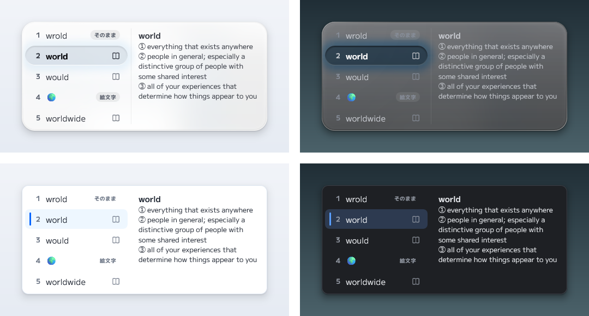
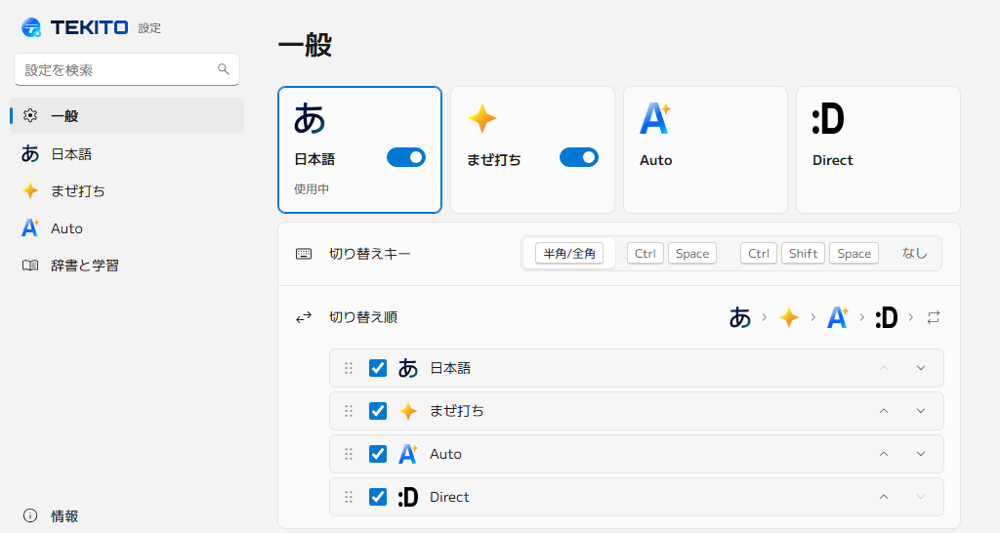

<p align="center">
  <picture>
    <source media="(prefers-color-scheme: dark)" srcset="docs/images/header-dark.png">
    
  </picture>
</p>

<p align="center">
  Windows で英語と日本語を入力するための IME です。<br>
  英語の入力ミスは Space で修正し、ローマ字は文全体から日本語に変換します。<br>
  修正が不要なときは、入力したとおりに残します。
</p>

<p align="center">
  <a href="README.md">English</a> ·
  <a href="#インストール">インストール</a> ·
  <a href="#ビルド">ビルド</a> ·
  <a href="https://capitata.dev">capitata.dev</a>
</p>

<p align="center">
  
</p>

TEKITO は TSF のテキストサービスとして動作する IME で、一般的な Windows アプリでそのまま使えます。1 つの IME で英語と日本語の両方を入力できます。英語は入力中にスペルを修正し、日本語を追加するとローマ字をかなと漢字に変換します。処理はすべて PC の中で行います。

> TEKITO はプレビュー版です。動作を確認しているのはメモ帳のみです。そのほかのアプリの状況は[互換性メモ](docs/compatibility.md)にまとめています。

## モード

タスクバーのボタンに現在のモードを表示します。クリックで切り替え、右クリックでモードを選択できます。

<table>
  <tr>
    <td align="center"></td>
    <td><b>Auto</b><br>英語のスペルを修正し、入力中に単語を候補に表示します。</td>
  </tr>
  <tr>
    <td align="center">
      <picture>
        <source media="(prefers-color-scheme: dark)" srcset="docs/images/mode-direct-dark.png">
        
      </picture>
    </td>
    <td><b>Direct</b><br>押したキーをそのまま入力します。</td>
  </tr>
  <tr>
    <td width="72" align="center">
      <picture>
        <source media="(prefers-color-scheme: dark)" srcset="docs/images/mode-japanese-dark.png">
        
      </picture>
    </td>
    <td><b>日本語</b><br>ローマ字をかなと漢字に変換します。</td>
  </tr>
  <tr>
    <td align="center"></td>
    <td><b>まぜ打ち</b><br>日本語と英語を、切り替えずに Space で区切って入力します。</td>
  </tr>
</table>

切り替えキーは、日本語キーボードでは半角/全角、US キーボードでは Alt+` です（Ctrl+Space、Ctrl+Shift+Space、なしも選択できます）。**設定 → 一般** でオンにしたモードを、設定した順に切り替えます。日本語キーボードでは、変換キーで日本語、無変換キーで英語、ひらがなキーでひらがな（Shift でカタカナ）に切り替わります。切り替えると、入力位置に新しいモードを一時的に表示します。

日本語入力は、インストール時に追加するかを選択できます。追加していないとき、または **設定 → 一般** でオフにしたときは、Auto と Direct のみになります。ターミナル、管理者として実行中のアプリ、設定で指定したアプリでは、TEKITO はオフになります。

## 英語の入力

Auto では普段どおりに入力します。入力中の単語に下線が付き、その下に候補を表示します。

| キー | 動作 |
| --- | --- |
| Space | 確実な修正を適用し、スペースを入力します。続けて押すと次の候補を選択します。 |
| Shift+Space | 前の候補に戻ります。 |
| Tab、↑、↓ | 確定せずに候補を移動します。 |
| Backspace | 修正の直後に押すと、入力したとおりに戻します。 |
| Esc | 修正せず、入力したとおりにします。 |
| Enter | 候補の選択中はその候補で確定し、それ以外は通常どおり改行します。 |

次の文字を入力した時点で単語が確定するため、あとから取り消す操作はありません。辞書にある単語、「brb」のようなチャットの略語、大文字で入力した語、コードと思われる文字列、URL やアドレス、パスワード・数値・メールアドレスの入力欄は修正しません。

Space では英語の一般的な表記にも修正します。「i」は「I」に、「dont」「youre」にはアポストロフィを付け、「ofthe」は 2 語に分け、曜日・月・言語名や「iPhone」のような名前は大文字にします。「cant」「march」のように入力したままでも英単語になる場合はそのまま残し、もう一方の表記を次の候補に表示します。

候補には、次に続く単語も表示します（例：I want t → to）。「the the」のように同じ単語が続くと、Space で 1 つにします（Backspace で元に戻せます）。**設定 → Auto** では、これらのオン／オフのほか、**Space 2回でピリオド** と **引用符とダッシュを変換** を設定できます。

日付・記号・計算結果も候補に表示します。「today」「now」で日付と時刻、「heart」「(c)」「->」で ♡・©・→、「1+2=」で 3 です。入力したとおりが第1候補のままなので、選択しない限り変わりません。



## 日本語の入力

日本語を追加すると、日本語モードでローマ字を入力できます。入力中は下線付きのひらがなで表示し、Space で全体を文節に分けて変換します。もう一度 Space を押すと、選択中の文節の候補一覧を開きます。

<p align="center">
  
</p>

| キー | 動作 |
| --- | --- |
| Space | 変換します。変換後は次の候補、Shift+Space で前の候補を選択します。 |
| ← → | 変換前はカーソルを、変換後は選択する文節を移動します。 |
| Shift+← → | 選択中の文節を短く・長くします。 |
| 1〜9 | 候補一覧から選択します。 |
| Tab、↓ | 入力中に表示される予測候補から選択します。 |
| Enter | 表示どおりに確定します。 |
| Esc | 変換後はひらがなに戻し、変換前は入力を取り消します。 |
| PageUp、PageDown | 候補一覧のページを切り替えます。 |
| F6〜F8 | ひらがな、カタカナ、半角カタカナに変換します。 |
| F9、F10 | 入力した英字を全角に、または入力したとおりに変換します。 |
| Shift+英字 | 英単語の入力を始めます。日本語の途中では、続く英字をそのまま入力します（NHKの、Windows11）。 |
| 変換 | 未入力のとき、選択した文字（または確定直後の文字）を再変換します。 |
| Ctrl+Backspace | 確定直後に押すと、確定を取り消して変換中に戻します。 |
| Ctrl+Delete | 学習した候補（選択中の予測候補や候補）を削除します。 |

- **文全体で変換。** 日本語のニュースやウィキペディアの文章から学んだ語のつながりと、直前に確定した文をもとに変換します。さらに小さな言語モデルが候補の文を比べ、文として自然なものを第1候補にします。
- **入力ミスの修正。** 隣のキー、抜けや余分なキー、入れ替わった 2 文字などの入力ミスを見つけ、意図した語を「もしかして」付きで候補に表示します。入力したとおりの変換が第1候補のままなので、入力し直す必要はありません。
- **語の意味。** 意味のある候補には本のマークが付き、選択中の候補の意味を候補一覧の横に表示します。「初め」と「始め」の違いもその場で確認できます。「エモい」「推し活」のような口語にも意味を表示します。
- **カタカナ語の英語表記。** 外来語や名前には英語も候補に表示します（例：ミーティング → meeting、グーグル → Google）。JMdict と日本語版ウィキペディアのデータを使用しています。
- **学習。** 選択した変換を、次回から上位に表示します。
- **ユーザー辞書。** **設定 → 辞書と学習 → 日本語の単語** で、読みと表記を登録できます。
- **数字・日付・記号。** 数字を数として扱い、「3こ」は「3個」、「100えん」は「100円」に変換します。数字を変換すると、全角・半角や漢数字（千二百三十四）も候補に表示します。**設定 → 日本語** の **数字の変換** と **変換に使う漢字**（教育漢字の学年・常用・人名用）で、表記を選択できます。「きょう」「いま」で日付と時刻、「やじるし」「ほし」で記号、「にこにこ」で顔文字、「1+2=」で計算結果を表示します。単漢字は単語のあとに表示します。
- **郵便番号。** **設定 → 日本語 → 郵便番号から住所に変換** をオンにすると、日本郵便のデータをダウンロードし、「1000001」を住所に変換できます。
- **ライブ変換。** **設定 → 日本語 → ライブ変換** をオンにすると、入力と同時に変換します。Space で最後の文節の候補を選択できます。
- **絵文字。** 読みから絵文字も候補に表示します（例：ねこ → 🐱）。記号のあとに表示します。
- **ほかの IME との辞書の共有。** Microsoft IME、Google 日本語入力、ATOK からテキストで書き出した単語を、**設定 → 辞書と学習 → 辞書の読み込みと書き出し** で読み込めます。日本語の単語は、ほかの IME で読み込める形式で書き出せます。
- **かな入力とローマ字表。** **かな入力** では、JIS キーボードに印字されたかなを入力します。**ローマ字表** は編集でき、ほかの IME から読み込むこともできます。
- **多くの入力欄に対応。** スタートメニューの検索、設定アプリ、ストアアプリでも使えます。フリガナのようなカタカナの入力欄では、カタカナを入力します。

Microsoft IME、Google 日本語入力、ATOK は各社の商標です。TEKITO が読み込めるファイルを示すためにのみ名前を記載しています。TEKITO は各社と関係ありません。

### まぜ打ちモード

**設定 → 一般** でまぜ打ちをオンにすると、切り替えるモードに追加されます。日本語と英語を、切り替えずに Space で区切って入力できます。`kyouha github ni push suru` は「今日はGitHubにpushする」になります。区切りごとに日本語か英語かを判定し、ローマ字として読めない語（github、push）やよく知られた名前（API）は英語の正しい表記（GitHub）に、日本語は通常どおり変換します。「take」のようにどちらにも読める語は文脈に合わせ、日本語の文では日本語、英語が続く場合は英語にします。もう一度 Space を押すと、もう一方に切り替わります。Enter は表示どおりに確定し、変換はしません。

## 設定



各ページにはよく使う項目を表示し、そのほかの項目はページ末尾の **詳細** にまとめています。**設定 → 一般 → 入力の見本** では、各モードの入力を短い動画で確認できます。

設定画面、インストーラー、TEKITO のメッセージは日本語と英語に対応しています。通常は Windows の表示言語に合わせ、**設定 → 一般 → 表示言語** で変更できます。

## プライバシー

TEKITO の処理はすべて PC の中で行います。入力内容を外部に送信せず、アカウントやテレメトリもなく、入力中にネットワークを使用しません。学習した内容は `%LOCALAPPDATA%\TEKITO` に保存され、設定画面から削除できます。ダウンロードするのは、インストール時に日本語を選択した場合の日本語データと、設定で郵便番号をオンにした場合の郵便番号データのみです。詳しくは[プライバシーについて](PRIVACY.md)を参照してください。

## インストール

[Releases](https://github.com/Canta360/tekito/releases) から `TEKITO-0.6.1-full-installer.exe` をダウンロードして実行します。

- **日本語入力を追加する**（Windows の表示言語が日本語の場合はオン）を選択すると、日本語の辞書と言語データ（約 80 MB）を同じリリースからダウンロードし、チェックサムを照合してからインストールします。TEKITO は日本語のキーボード一覧に追加されます。英語は Auto と Direct で入力できるため、英語の一覧には追加しません（**オプション** で追加することもできます）。
- 日本語を選択しない場合は、英語のキーボード一覧に Auto と Direct の TEKITO を追加します。日本語は、インストーラーを再度実行すると追加できます。
- Microsoft Edge WebView2 Runtime が必要です。Windows 11 には標準で含まれています。

インストール後、使用するアプリを再起動するか、サインアウトしてサインインし直し、Win+Space で TEKITO を選択します。

インストーラーにはまだコード署名がないため、Windows SmartScreen が実行の確認を求めることがあります。オフラインでのインストール方法は[インストール手順](installer/INSTALL_JP.md)にあります。

## ビルド

Windows 11、C++ デスクトップ開発ワークロード入りの Visual Studio 2026（または 2022）、CMake 3.24 以降、Python 3、設定画面用の Node.js が必要です。

```powershell
cd apps\tekito-settings\ui
npm ci
npm run build
cd ..\..\..
cmake --preset windows-x64-debug
cmake --build --preset windows-x64-debug
.\scripts\verify.ps1
```

`verify.ps1` はビルド、テスト、[開発のルール](#開発のルール)の確認をまとめて行います。自分のビルドを試すときは、管理者 PowerShell で `scripts\register-debug.ps1` を実行して登録し、`unregister-debug.ps1` で外します。

言語データは `data/` にあります。大きなパックはリポジトリに入れず、公開元から作ります。

- `scripts\ja\prepare-japanese-packs.ps1` は、Mozc から日本語辞書を、Leipzig のコーパスから語の統計を、TEKITO の slang の一覧と Wiktionary、日本語 WordNet から意味のデータを作ります。これがないと、日本語はかなまでで漢字に変換できません。
- `scripts\en\prepare-full-data-packs.ps1` は英語のフレーズ統計を作ります。なくても TEKITO は動きます。

各パックの出典とライセンスは [Data Packs](docs/data-packs.md) にまとめてあります。インストーラーを作るときは `windows-x64-release` プリセットでビルドし、`installer\package-release.ps1` を実行します。リリースに添付する日本語データの ZIP も一緒に作られます。

## 構成

| パス | 内容 |
| --- | --- |
| `src/Core` | 英語の候補の検索・順位付けと入力の状態遷移。Windows に依存しません。 |
| `src/Core/Japanese` | ローマ字、かな漢字変換、打ち間違いの候補、予測、意味。Windows に依存しません。 |
| `src/Tsf` | TSF テキストサービスと候補ウィンドウ。 |
| `src/UserData` | 設定、ユーザー辞書、学習データ（SQLite）。 |
| `tests` | エンジンとユーザーデータのテスト（日本語のテスト用データは `tests/data/ja`）。 |
| `eval`、`benchmarks` | 精度と速さをオフラインで測る仕組み。`en` と `ja` に分かれています。 |
| `apps/tekito-settings` | 設定画面。Win32 のホストと WebView2 上の React。 |
| `installer` | セットアップと配布物を作るスクリプト。 |
| `data` | 言語データ。パックごとに manifest と NOTICE があります。英語は `en`、日本語は `ja`、両方で使うものは `common` にあります。 |
| `scripts` | ビルド、インストール、確認のスクリプト。言語ごとのデータを作るものは `en` と `ja` にあります。 |

## 開発のルール

- 単語やフレーズはデータに置き、`if` 文に書かない。
- 入力の処理経路でネットワークを使わない。診断情報に入力内容を含めない。
- TSF だけで動かす。キーボードフックや擬似入力は使わない。
- 正しい単語、名前、コードはそのままにする。迷ったら置き換えずに候補として出す。

不具合の報告やアイデアは Issues で受け付けています。プレビューの間はプルリクエストを受け付けていません。

## ライセンス

ソースコードは [Functional Source License 1.1](LICENSE.md)（FSL-1.1-ALv2）で公開しています。競合する商用製品に使うこと以外なら、使う・改変する・共有するのは自由です。各リリースは公開から 2 年後に Apache 2.0 になります。配布するインストーラーには [TEKITO 使用許諾契約](installer/TEKITO_LICENSE.md)が、言語データにはそれぞれの出典のライセンスが適用されます。日本語では Mozc の辞書（IPAdic と BSD 3-Clause）、Leipzig Corpora Collection（CC BY 4.0）、Wiktionary（CC BY-SA 4.0）、日本語 WordNet を使っています。詳しくは[ライセンスについて](LICENSING.md)と[サードパーティー通知](THIRD_PARTY_NOTICES.md)を参照してください。

TEKITO は [Capitata](https://capitata.dev) が開発しています。

<p align="center">
  <a href="https://capitata.dev">
    <picture>
      <source media="(prefers-color-scheme: dark)" srcset="docs/images/capitata-dark.png">
      
    </picture>
  </a>
</p>
