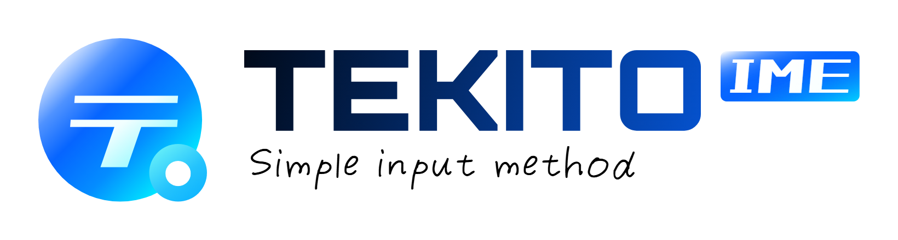
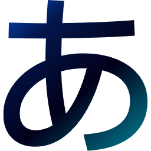
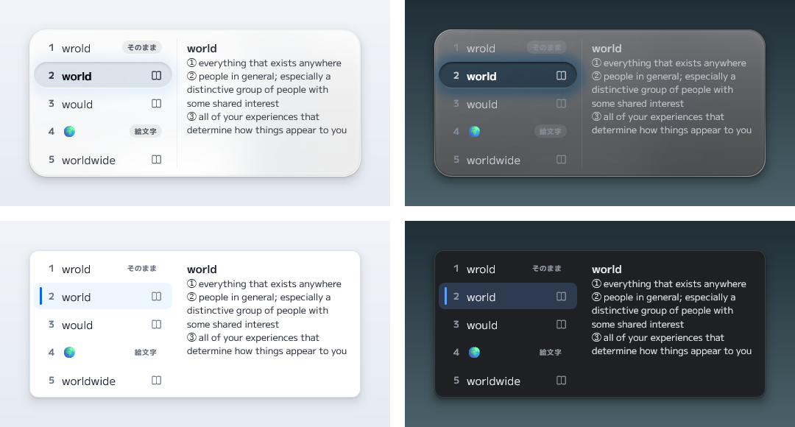
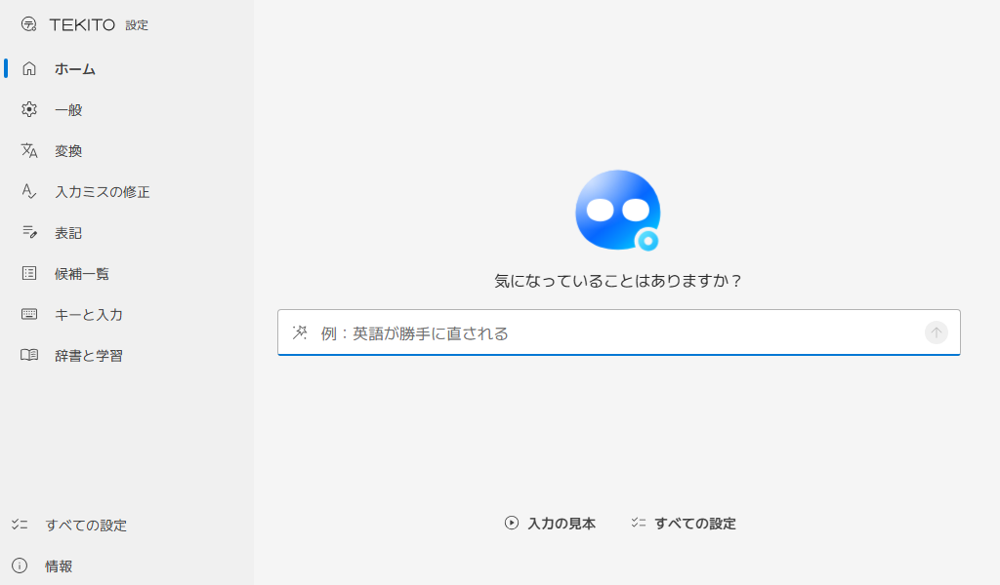

<p align="center">
  <picture>
    <source media="(prefers-color-scheme: dark)" srcset="docs/images/header-dark.png">
    
  </picture>
</p>

<p align="center">
  Windows で英語と日本語を入力するための IME です。<br>
  英語の入力ミスは Space で修正され、ローマ字は文全体から日本語に変換されます。<br>
  修正が不要なときは、入力したとおりに保持されます。
</p>

<p align="center">
  <a href="README.md">English</a> ·
  <a href="#インストール">インストール</a> ·
  <a href="#ビルド">ビルド</a> ·
  <a href="https://capitata.dev">capitata.dev</a>
</p>

<p align="center">
  <br>
  <sub>英語（オート）：Space、カンマ、ピリオドで入力ミスが修正されます</sub>
</p>

TEKITO は TSF のテキストサービスとして動作する IME で、一般的な Windows アプリでそのまま使用できます。1 つの IME で英語と日本語の両方を入力できます。英語は入力中にスペルが修正され、ローマ字はかなと漢字に変換されます。処理はすべて PC の中で行われます。動作を確認したアプリは[互換性メモ](docs/compatibility.md)にまとめています。

## モード

タスクバーのボタンに現在のモードが表示されます。クリックで切り替えられ、右クリックでモードの選択、シークレットモード、設定画面を開くことができます。

<table>
  <tr>
    <td align="center"></td>
    <td><b>Auto</b><br>英語のスペルが修正され、入力中の単語が候補に表示されます。</td>
  </tr>
  <tr>
    <td align="center">
      <picture>
        <source media="(prefers-color-scheme: dark)" srcset="docs/images/mode-direct-dark.png">
        
      </picture>
    </td>
    <td><b>Direct</b><br>押したキーがそのまま入力されます。</td>
  </tr>
  <tr>
    <td width="72" align="center">
      <picture>
        <source media="(prefers-color-scheme: dark)" srcset="docs/images/mode-japanese-dark.png">
        
      </picture>
    </td>
    <td><b>日本語</b><br>ローマ字がかなと漢字に変換されます。</td>
  </tr>
  <tr>
    <td align="center"></td>
    <td><b>まぜ打ち</b><br>日本語と英語を、切り替えずに Space で区切って入力できます。</td>
  </tr>
</table>

切り替えキーは、日本語キーボードでは半角/全角、US キーボードでは Alt+` です（Ctrl+Space、Ctrl+Shift+Space、なしも選択できます）。**設定 → 一般 → 切り替え順** でチェックしたモードが、その順に切り替わります。日本語キーボードでは、変換キーで日本語、無変換キーで英語、ひらがなキーでひらがな（Shift でカタカナ）に切り替わります。

日本語入力は、インストール時に追加するかを選択できます。追加しない場合は、Auto と Direct のみになります。ターミナル、管理者として実行中のアプリ、**設定 → 一般** で指定したアプリでは、TEKITO はオフになります。

**シークレットモード** をオンにすると、オフにするまで、すべてのアプリで入力内容が学習・保存されません。サインアウトや再起動をするとオフに戻ります。

## 英語の入力

Auto では、普段どおりに入力できます。入力中の単語には下線が付き、その下に候補が表示されます。

| キー | 動作 |
| --- | --- |
| Space | 確実な修正が適用され、スペースが入力されます。続けて押すと、次の候補を選択できます。 |
| Shift+Space | 前の候補に戻ります。 |
| Tab、↑、↓ | 確定せずに候補を移動できます。 |
| Backspace | 修正の直後に押すと、入力したとおりに戻ります。 |
| Esc | 修正されず、入力したとおりになります。 |
| Enter | 候補の選択中はその候補で確定され、それ以外は通常どおり改行されます。 |

辞書にある単語、「brb」のようなチャットの略語、大文字で入力した語、コードと思われる文字列、URL やアドレス、パスワード・数値・メールアドレスの入力欄は修正されません。

Space では、英語の一般的な表記にも修正されます。「i」は「I」に、「dont」にはアポストロフィが付き、曜日・月や「iPhone」のような名前は大文字になります。「cant」のように入力したままでも英単語になる場合はそのまま保持され、もう一方の表記が次の候補に表示されます。候補には次に続く単語も表示され（例：I want t → to）、「today」「heart」「1+2=」では日付、♡、3 が表示されます。それぞれ設定画面でオン／オフを切り替えられます。



## 日本語の入力

日本語モードでローマ字を入力すると、下線付きのひらがなで表示されます。Space で全体が文節に分割されて変換され、もう一度 Space を押すと、選択中の文節の候補一覧が表示されます。

<p align="center">
  <br>
  <sub>日本語：Space で、入力ミスが修正されて変換されます</sub>
</p>

<p align="center">
  <br>
  <sub>ライブ変換：入力と同時に変換され、手を止めると文全体で修正されます</sub>
</p>

| キー | 動作 |
| --- | --- |
| Space | 変換されます。変換後は次の候補、Shift+Space で前の候補を選択できます。 |
| ← → | 変換前はカーソルを、変換後は選択する文節を移動できます。 |
| Shift+← → | 選択中の文節を短く・長くできます。 |
| 1〜9 | 候補一覧から選択できます。 |
| Tab、↓ | 入力中に表示される予測候補から選択できます。 |
| Enter | 表示どおりに確定されます。 |
| Esc | 変換後はひらがなに戻り、変換前は入力が取り消されます。 |
| F6〜F8 | ひらがな、カタカナ、半角カタカナに変換されます。 |
| F9、F10 | 入力した英字が、全角に、または入力したとおりに変換されます。 |
| Shift+英字 | 日本語の途中で英字の入力が始まります（NHKの、Windows11）。 |
| 変換 | 未入力のとき、選択した文字が再変換されます。 |
| Ctrl+Backspace | 確定直後に押すと、確定が取り消され、変換中に戻ります。 |
| Ctrl+Delete | 学習した候補が削除されます。 |

- **文全体で変換。** 語のつながりと、カーソルの前の文をもとに変換され、小さな言語モデルによって文として自然なものが第1候補になります。
- **入力ミスの修正。** 隣のキー、抜けや余分なキー、入れ替わった 2 文字などの入力ミスは、修正されてから変換されます（arigayou → ありがとう）。入力したとおりの変換も候補に表示されます。
- **続く言葉とまとめた候補。** 選択中の文節と続く文節をまとめて、別の書き方にした候補も表示されます（きしゃにきいた → 記者に聞いた、貴社に聞いた）。
- **語の意味。** 選択中の候補の意味が候補一覧の横に表示され、「初め」と「始め」の違いもその場で確認できます。「エモい」のような口語にも意味が表示されます。
- **カタカナ語の英語表記。** 外来語や名前には、英語も候補に表示されます（ミーティング → meeting、グーグル → Google）。
- **学習とユーザー辞書。** 選択した変換が、次回から上位に表示されます。**設定 → 辞書と学習** で単語を登録でき、Microsoft IME、Google 日本語入力、ATOK から書き出した単語も読み込めます。
- **数字・日付・記号。** 「3こ」は「3個」、「100えん」は「100円」に、**設定 → 表記** で設定した形式で変換されます。使用する漢字（教育漢字の学年・常用・人名用）も同じページで選択できます。「きょう」「いま」で日付と時刻、「やじるし」で記号、「ねこ」で絵文字、「にこにこ」で顔文字、「1+2=」で計算結果が表示されます。
- **郵便番号。** **設定 → 候補一覧 → 郵便番号から住所に変換** を有効にすると、「1000001」を住所に変換できます。
- **ライブ変換。** **設定 → 変換** で有効にすると、入力と同時に変換されます。
- **かな入力とローマ字表。** **設定 → キーと入力** にあります。
- **多くの入力欄に対応。** スタートメニューの検索、設定アプリ、ストアアプリでも使用できます。フリガナのようなカタカナの入力欄では、カタカナが入力されます。

### まぜ打ち

**設定 → 一般 → 切り替え順** でまぜ打ちにチェックを入れると、日本語と英語を、切り替えずに Space で区切って入力できます。`kyouha github ni push suru` は「今日はGitHubにpushする」になります。区切りごとに日本語か英語かが判別され、名前は正しい表記（GitHub）に、どちらにも読める語は文脈に合わせて変換されます。もう一度 Space を押すと、もう一方に切り替わります。日本語のあとに大文字を入力すると英語が始まり（`kyouhaZoom` → 今日はZoom）、Enter で表示どおりに確定されます。

<p align="center">
  <br>
  <sub>まぜ打ち：日本語、英語、混ざった文、区切らずに入力した文</sub>
</p>

ライブ変換はまぜ打ちでも使えます。区切らずに入力した文も、入力と同時に変換されます。

<p align="center">
  <br>
  <sub>まぜ打ち＋ライブ変換：区切らずに入力</sub>
</p>

### AI（任意）

**設定 → 変換 → AI で見直す** を有効にすると、日本語の変換結果が AI によって確認されます。AI はこの PC の CPU、GPU、NPU のいずれかで動作し、入力内容が外部に送信されることはありません。軽量（約 360 MB）と高精度（約 1.6 GB）から選択できます。

Microsoft IME、Google 日本語入力、ATOK は各社の商標です。TEKITO が読み込めるファイルを示すためにのみ名前を記載しています。TEKITO は各社と関係ありません。

## 設定



ホームでは、設定を名前で探せます。AI モデルをダウンロードしている場合は、「英語が勝手に直される」のように言葉で聞くこともでき、AI によって設定が変更されます（元に戻すこともできます）。各ページにはよく使う項目が表示され、そのほかの項目はページ末尾の **詳細** にまとめられています。**すべての設定** では、すべての設定を 1 ページで確認できます。

**設定 → 辞書と学習** で、辞書と学習内容を暗号化できます（回復コード付き）。ホームのコンパニオンをデスクトップの隅に表示することもできます（**設定 → 一般**）。設定画面、インストーラー、TEKITO のメッセージは日本語と英語に対応しています。

## プライバシー

TEKITO の処理はすべて PC の中で行われます。入力内容が外部に送信されることはなく、アカウントやテレメトリもなく、入力中にネットワークは使用されません。学習した内容は `%LOCALAPPDATA%\TEKITO` に保存され、設定画面から削除できます。ダウンロードが行われるのは、選択した場合の日本語データ、郵便番号データ、AI モデル、GPU や NPU で動かすための部品のみです。詳しくは[プライバシーについて](PRIVACY.md)を参照してください。

## インストール

[Releases](https://github.com/Canta360/tekito/releases/latest) から `TEKITO-1.0.1-full-installer.exe` をダウンロードして実行します。

- **日本語入力を追加する**（Windows の表示言語が日本語の場合はオン）を選択すると、日本語の辞書と言語データ（約 232 MB）が同じリリースからダウンロードされ、照合されてからインストールされます。TEKITO は日本語のキーボード一覧に追加されます。
- **AI で変換を見直す** を選択すると、AI モデル（約 720 MB）もダウンロードされます。
- 日本語を追加しない場合は、英語のキーボード一覧に Auto と Direct の TEKITO が追加されます。日本語は、あとから設定画面で追加できます。
- Microsoft Edge WebView2 Runtime が必要です。Windows 11 には標準で含まれています。

インストール後、使用するアプリを再起動するか、サインアウトしてサインインし直し、Win+Space で TEKITO を選択してください。

インストーラーにはコード署名がないため、Windows SmartScreen が実行の確認を求めることがあります。オフラインでのインストール方法は[インストール手順](installer/INSTALL_JP.md)にあります。

## ビルド

Windows 11、C++ デスクトップ開発ワークロード入りの Visual Studio 2026（または 2022）、CMake 3.24 以降、Python 3、設定画面用の Node.js が必要です。

```powershell
cd apps\tekito-settings\ui
npm ci
npm run build
cd ..\..\..
cmake --preset windows-x64-debug
cmake --build --preset windows-x64-debug
.\scripts\verify.ps1
```

`verify.ps1` では、ビルド、テスト、[開発のルール](CONTRIBUTING_JP.md#ルール)の確認がまとめて行われます。自分のビルドを試すときは、管理者 PowerShell で `scripts\register-debug.ps1` を実行して登録し、`unregister-debug.ps1` で登録を解除できます。

言語データは `data/` にあります。大きなパックは公開元のデータから作成します。日本語の辞書と言語データは `scripts\ja\prepare-japanese-packs.ps1`（これがないと、日本語はかなまでしか変換されません）、英語のフレーズ統計は `scripts\en\prepare-full-data-packs.ps1` で作成できます。各パックの出典とライセンスは [Data Packs](docs/data-packs.md)、リリースの作り方は[インストーラーについて](installer/README.md)にまとめています。

| パス | 内容 |
| --- | --- |
| `src/Core` | 英語の候補・順位付けと入力の状態遷移。Windows に依存しません。 |
| `src/Core/Japanese` | ローマ字、かな漢字変換、入力ミス、予測、意味。Windows に依存しません。 |
| `src/Tsf` | TSF テキストサービス、候補ウィンドウ、タスクバーのメニュー。 |
| `src/UserData` | 設定、ユーザー辞書、学習データ（SQLite）。 |
| `apps/tekito-settings` | 設定画面。Win32 のホストと WebView2 上の React。 |
| `installer` | セットアップと配布物を作るスクリプト。 |
| `data` | 言語データ。英語は `en`、日本語は `ja`、両方で使うものは `common`。 |
| `tests`、`eval`、`benchmarks` | テストと、精度・速さの測定。 |
| `scripts` | ビルド、インストール、確認、言語データの作成のスクリプト。 |

## 貢献について

不具合の報告、アイデア、プルリクエストを受け付けています。詳しくは[貢献について](CONTRIBUTING_JP.md)を参照してください。

## ライセンス

ソースコードには [Functional Source License 1.1](LICENSE.md)（FSL-1.1-ALv2）、配布するインストーラーには [TEKITO 使用許諾契約](installer/TEKITO_LICENSE.md)、言語データにはそれぞれの出典のライセンスが適用されます。正式な内容は、英語の各文書と[ライセンスについて](LICENSING.md)、[サードパーティー通知](THIRD_PARTY_NOTICES.md)を参照してください。

TEKITO は [Capitata](https://capitata.dev) と[貢献者](CONTRIBUTORS.md)が開発しています。

<p align="center">
  <a href="https://capitata.dev">
    <picture>
      <source media="(prefers-color-scheme: dark)" srcset="docs/images/capitata-dark.png">
      
    </picture>
  </a>
</p>
